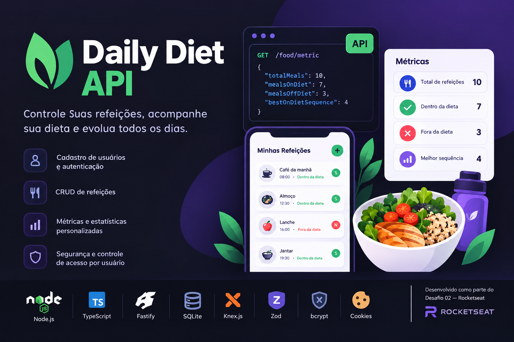

<p align="center">
  
</p>

# Daily Diet API

API REST desenvolvida com Node.js e TypeScript para controle de refeições e acompanhamento da alimentação diária dos usuários.

Este projeto foi desenvolvido como parte do **Desafio 02 — Criando APIs RESTful com Node.js e FastiFy**, da Rocketseat.

## 🚀 Funcionalidades

- Cadastro de usuários.
- Autenticação com e-mail e senha.
- Identificação do usuário entre requisições por meio de cookies de sessão.
- Cadastro de refeições vinculadas ao usuário autenticado.
- Edição de refeições.
- Exclusão de refeições.
- Listagem de todas as refeições do usuário.
- Visualização de uma refeição específica.
- Consulta de métricas individuais:
  - Quantidade total de refeições registradas.
  - Quantidade de refeições dentro da dieta.
  - Quantidade de refeições fora da dieta.
  - Maior sequência de refeições dentro da dieta.
- Restrição de acesso: cada usuário pode visualizar, editar e excluir somente as próprias refeições.

## 🛠️ Tecnologias utilizadas

- **Node.js** — ambiente de execução JavaScript.
- **TypeScript** — tipagem estática para maior segurança no desenvolvimento.
- **Fastify** — framework para construção da API.
- **Knex.js** — query builder para interação com o banco de dados e gerenciamento de migrations.
- **SQLite** — banco de dados relacional.
- **Zod** — validação dos dados recebidos pela API.
- **bcrypt** — criptografia de senhas por meio de hash.
- **Cookies** — identificação da sessão do usuário.

## 📋 Pré-requisitos

Antes de executar o projeto, você precisa ter instalado:

- [Node.js](https://nodejs.org/)
- npm, instalado junto com o Node.js.
- Git, para clonar o repositório.

## ⚙️ Instalação e execução

### 1. Clone o repositório

```bash
git clone <URL_DO_REPOSITORIO>
```

### 2. Acesse a pasta do projeto

```bash
cd <PASTA_DO_PROJETO>
```

### 3. Instale as dependências

```bash
npm install
```

### 4. Execute as migrations

Crie a estrutura do banco de dados executando as migrations do Knex:

```bash
npm run knex -- migrate:latest
```

### 5. Inicie o servidor

```bash
npm run dev
```

A API será iniciada na porta definida na configuração do servidor.

## 📌 Endpoints

Os endpoints abaixo consideram que as rotas foram registradas com os prefixos `/users`, `/sessions` e `/food`. Ajuste os caminhos caso sua configuração seja diferente.

| Método   | Rota            | Descrição                                  |
| -------- | --------------- | ------------------------------------------ |
| `POST`   | `/users`        | Cadastra um novo usuário                   |
| `POST`   | `/sessions`     | Autentica o usuário e cria uma sessão      |
| `POST`   | `/food`         | Cadastra uma refeição                      |
| `GET`    | `/food`         | Lista as refeições do usuário autenticado  |
| `GET`    | `/food/:foodId` | Busca uma refeição específica              |
| `PUT`    | `/food/:foodId` | Atualiza uma refeição                      |
| `DELETE` | `/food/:foodId` | Exclui uma refeição                        |
| `GET`    | `/food/metric`  | Retorna as métricas do usuário autenticado |

## 👤 Cadastro de usuário

Para cadastrar um usuário, envie uma requisição `POST` para `/users` com os dados necessários.

Exemplo de corpo da requisição:

```json
{
  "name": "Matheus",
  "email": "matheus@example.com",
  "password": "senha123"
}
```

A senha é armazenada em formato de hash utilizando bcrypt, evitando o armazenamento em texto puro.

## 🔐 Autenticação

A autenticação é realizada por meio de e-mail e senha.

Exemplo de corpo da requisição:

```json
{
  "email": "matheus@example.com",
  "password": "senha123"
}
```

Após a autenticação, a API cria uma sessão e envia um cookie chamado `sessionId`.

Esse cookie é utilizado para identificar o usuário nas próximas requisições.

As operações protegidas verificam a sessão e garantem que cada usuário tenha acesso somente às próprias refeições.

## 🍽️ Cadastro de refeições

Cada refeição é associada ao usuário autenticado e contém informações como nome, descrição, data e hora de registro e situação em relação à dieta.

Exemplo de corpo da requisição:

```json
{
  "name": "Almoço",
  "description": "Arroz, feijão, frango e salada",
  "diet": "s"
}
```

O campo `diet` indica se a refeição está dentro ou fora da dieta:

- `s`: refeição dentro da dieta.
- `n`: refeição fora da dieta.

Os dados recebidos são validados antes de serem armazenados no banco de dados.

## 📊 Métricas do usuário

A API disponibiliza um endpoint para consultar as métricas das refeições do usuário autenticado.

As métricas retornadas são:

| Métrica              | Descrição                                                |
| -------------------- | -------------------------------------------------------- |
| `totalMeals`         | Quantidade total de refeições registradas                |
| `mealsOnDiet`        | Quantidade de refeições dentro da dieta                  |
| `mealsOffDiet`       | Quantidade de refeições fora da dieta                    |
| `bestOnDietSequence` | Maior sequência consecutiva de refeições dentro da dieta |

A maior sequência é calculada considerando a ordem cronológica das refeições. Quando uma refeição está fora da dieta, a sequência atual é reiniciada.

Exemplo de resposta:

```json
{
  "totalMeals": 10,
  "mealsOnDiet": 7,
  "mealsOffDiet": 3,
  "bestOnDietSequence": 4
}
```

Os valores acima são apenas ilustrativos.

## 🛡️ Segurança e validação

A aplicação implementa mecanismos para proteger os dados dos usuários:

- Validação dos dados recebidos com Zod.
- Armazenamento de senhas utilizando hash com bcrypt.
- Identificação do usuário por meio de cookie de sessão.
- Associação das refeições ao usuário responsável pelo registro.
- Verificação de propriedade antes de visualizar, editar ou excluir uma refeição.

Essas medidas ajudam a garantir que os usuários não tenham acesso às refeições de outras contas.

## 🗄️ Banco de dados

A aplicação utiliza SQLite como banco de dados relacional e Knex.js para executar consultas e gerenciar migrations.

As migrations permitem criar e atualizar a estrutura das tabelas de maneira organizada e reproduzível.

O arquivo local do banco de dados deve ser mantido fora do versionamento, utilizando o `.gitignore`, para evitar o envio de dados locais ao repositório.

## 🎯 Objetivo do projeto

O objetivo deste projeto é consolidar os conhecimentos de desenvolvimento de APIs REST com Node.js, trabalhando com:

- Criação e organização de rotas.
- Validação de dados.
- Operações CRUD.
- Persistência de dados em banco relacional.
- Autenticação baseada em sessão.
- Autorização e controle de acesso por usuário.
- Consultas e cálculos de métricas.
- Testes automatizados.

---

Desenvolvido como parte dos estudos de desenvolvimento backend na **Rocketseat**.
